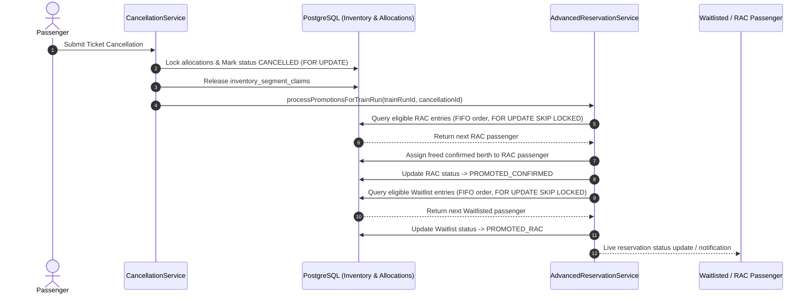
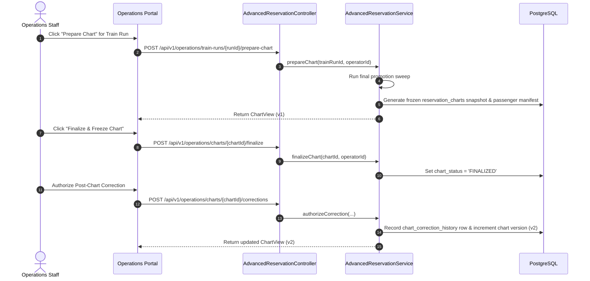

# Advanced Reservation Architecture (Phase 12)

RailConnect's Advanced Reservation Architecture provides a rule-driven platform for quota allocation, Reservation Against Cancellation (RAC), Waiting Lists (WL), cancellation-driven automatic promotion, and operational departure chart preparation.

---

## 1. Core Principles

1. **Physical Capacity Bounds**:
   The sum of all quota berth allocations for any class and train run must never exceed the train's actual physical capacity:
   $$\sum_{q \in \text{Quotas}} \text{AllocatedBerths}(q, \text{class}) \le \text{PhysicalCapacity}(\text{class})$$

2. **Sequential FIFO Queuing**:
   Both RAC and Waitlist queues assign monotonically increasing, gap-free transactional sequences per `(train_run_id, coach_class_code, quota_code)`.

3. **Atomic Multi-Stage Promotion**:
   When inventory is released (e.g. from cancellations), promotions cascade atomically:
   $$\text{Berth Released} \longrightarrow \text{RAC Pax promoted to Confirmed Berth} \longrightarrow \text{WL Pax promoted to RAC}$$

4. **Departure Chart Immutability**:
   Finalized charts are frozen snapshots. Operational corrections generate new chart versions and preserve full audit history.

---

## 2. Sequence Diagrams

### 2.1 Cancellation-Driven Promotion Flow

### 2.2 Chart Preparation & Operational Manifest Flow

