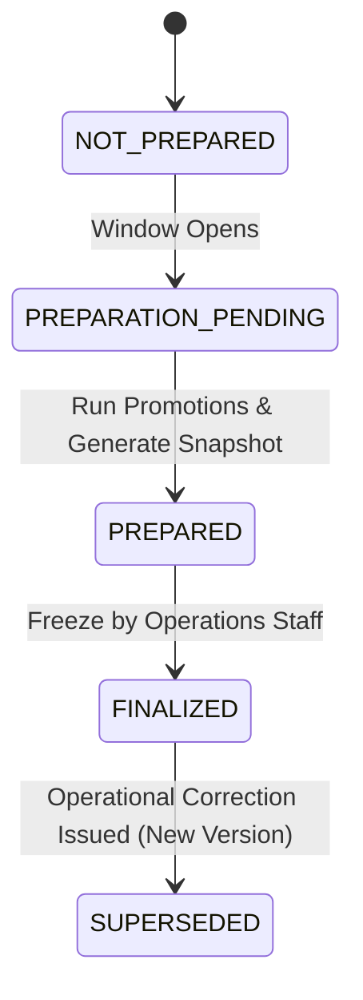

# Departure Chart Preparation & Manifest Management

RailConnect departure charts represent immutable snapshots of train reservations at the time of operational chart preparation.

---

## 1. Chart Lifecycle

---

## 2. Operational Manifest Content

Each chart manifest record in `reservation_chart_passengers` contains:
- `pnr`: The passenger PNR.
- `passenger_name`: Passenger full name.
- `coach_number` & `berth_number` & `berth_type`: Allocated berth details.
- `coach_class_code`: Travel class.
- `reservation_status`: `CONFIRMED`, `RAC`, or `WAITLISTED`.
- `from_station_code` & `to_station_code`: Station boarding and destination codes.

