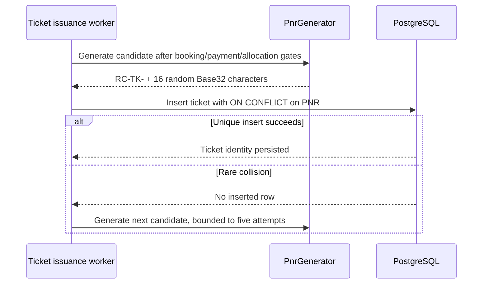

# RailConnect PNR Generation

PNRs use the independent RailConnect format `RC-TK-` followed by 16 Base32 characters from 80 bits generated by Java `SecureRandom`. This format is not intended to resemble an official railway PNR. The database enforces the format and a unique constraint; `PnrGenerator` is server-only.

## Generation flow

Only a confirmed booking with independently verified successful payment and every passenger's confirmed allocation can reach generation. A unique booking constraint and locked issuance job make duplicate confirmation processing idempotent. Existing ticket rows are reused; a new PNR is never generated for a retry of an already-issued booking. The PNR is immutable and ticket rows cannot be deleted.

The ticket has one booking-level PNR. Each passenger receives a separate random `RC-PAX-` ticket reference, coach/berth assignment, and fare snapshot.
