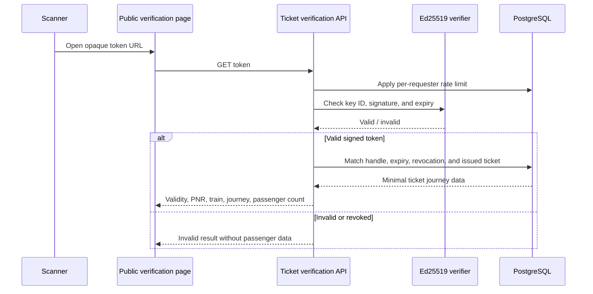

# QR Ticket Verification

The server creates a random 128-bit public handle and persists it with the ticket and expiry. It signs `keyId.handle.expiryEpochSeconds` with Ed25519. The QR encodes the static-export-compatible public `/verify-ticket?token={token}` URL. It contains no passenger name, PNR, internal database identifier, or financial information.

## Verification sequence

`GET /api/v1/ticket-verification/{token}` is rate-limited to a configurable number of requests per minute per hashed requester address. It returns only the PNR, current issued status, train and journey information, passenger count, verification timestamp, and the independent-platform disclaimer. It never returns passenger names, contact details, seat assignments, or payment reference. Staff may verify by PNR or signed token through separate permission-protected routes; operations responses include coach/berth allocations but not names.

The active Ed25519 key ID and private/public key pair are deployment configuration. Missing signing material fails closed. Tokens expire after the configured lifetime (default 24 hours, maximum seven days); a subsequent authorized PDF download can create a fresh handle. Cancellation/refund flows are not part of Phase 10.
