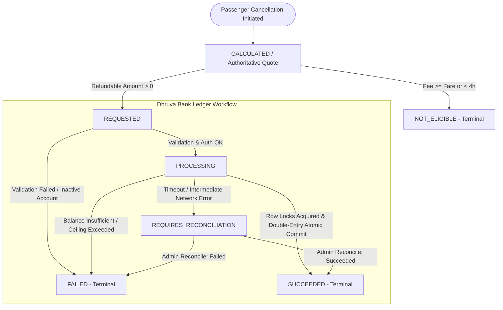

# Refund Management & State Lifecycle

This document describes the state lifecycle, state transitions, and idempotency invariants governing refunds in RailConnect and their alignment with Dhruva Bank's core banking ledger.

---

## 1. State Diagram

---

## 2. State Descriptions

| State | Description | Next Allowed States |
| :--- | :--- | :--- |
| `NOT_ELIGIBLE` | Cancellation fee equals or exceeds original ticket fare (e.g. cancelled under 4 hours before departure). No refund dispatch needed. | None (Terminal) |
| `CALCULATED` | Authoritative cancellation quote computed via backend policy engine. Awaiting passenger confirmation. | `REQUESTED`, `NOT_ELIGIBLE` |
| `REQUESTED` | Refund request accepted by RailConnect and dispatched to Dhruva Bank (`POST /api/v1/merchant/refunds`). | `PROCESSING`, `FAILED` |
| `PROCESSING` | Dhruva Bank has acquired row-level locks on accounts (`accounts` & `merchant_payment_intents`); balance and refundable ceiling validated. | `SUCCEEDED`, `FAILED`, `REQUIRES_RECONCILIATION` |
| `SUCCEEDED` | Debit and Credit written to core transactions and balances updated atomically via double-entry ledger. | None (Terminal) |
| `FAILED` | Insufficient merchant settlement balance, ceiling exceeded, or inactive account. | None (Terminal) |
| `REQUIRES_RECONCILIATION` | Exception or network timeout occurred during intermediate commit requiring staff/admin audit. | `SUCCEEDED`, `FAILED` (Admin resolved) |

---

## 3. Idempotency Invariants

- Each refund request is bound to `(merchant_id, idempotency_key)` and `(merchant_id, merchant_refund_ref)` with unique database constraints.
- If a request is received with an existing idempotency key:
  - If the previous attempt is `SUCCEEDED`, Dhruva Bank returns the existing refund details with HTTP 200 and `is_idempotent_replay: true`.
  - No new debit or credit ledger entries are generated.
  - RailConnect records the replay in `refund_attempts` and keeps the primary `refund_orders` row idempotent.

---

## 4. Reconciliation Console
Staff can inspect any refund order in `REQUIRES_RECONCILIATION` state from the Admin Portal (`/admin` -> **Cancellations & Refunds** tab) and trigger `/api/v1/admin/cancellations/refunds/{refundId}/reconcile` to query Dhruva Bank authoritative state and settle the order.

