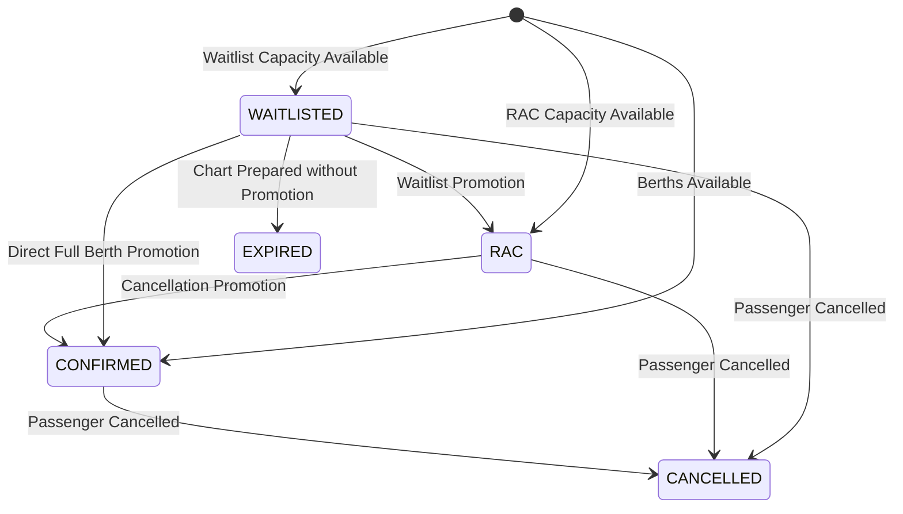

# Reservation State Machine

This document defines the authoritative states and valid transitions for passengers, bookings, and departure charts in RailConnect.

---

## 1. Passenger Reservation States

---

## 2. Transition Guard Matrix

| From State | Allowed To States | Trigger Event |
| :--- | :--- | :--- |
| `WAITLISTED` | `RAC`, `CONFIRMED`, `CANCELLED`, `EXPIRED` | Prior cancellation or chart finalization |
| `RAC` | `CONFIRMED`, `CANCELLED` | Prior cancellation |
| `CONFIRMED` | `CANCELLED` | Passenger cancellation |
| `CANCELLED` | *None* | Terminal state |
| `EXPIRED` | *None* | Terminal state |
