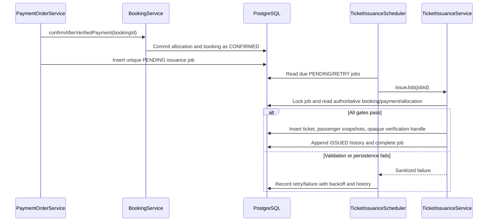

# Ticket Issuance Flow

The payment-confirmation transaction writes a unique issuance job after authoritative payment verification and booking confirmation. It does not synchronously render a PDF, call the payment provider again, or allocate inventory.

## Issuance sequence



The `issueJob` transaction requires `bookings.status = CONFIRMED`, a `SUCCEEDED` payment with a verified status-history source, at least one passenger, and a confirmed reservation allocation for every booking passenger. Ticket creation, passenger snapshots, verification-handle registration, job completion, and issue history are in the same transaction. The database uniqueness constraints provide a final duplicate guard.

Retries use bounded exponential backoff and stop after ten failed attempts. A repeated job for an existing ticket marks the job complete and records an idempotent replay; it does not change the ticket or PNR. PDF bytes are generated on demand from the stored ticket and authoritative booking/payment records.

```mermaid
sequenceDiagram
    participant Passenger
    participant Portal as Passenger Portal
    participant TicketAPI as Ticket API
    participant DB as PostgreSQL
    Passenger->>Portal: Open confirmed booking
    Portal->>TicketAPI: GET booking ticket (authenticated)
    TicketAPI->>DB: Select ticket by booking and owner
    alt Issuance complete
        DB-->>TicketAPI: Ticket record and passenger snapshots
        TicketAPI-->>Portal: PNR and ticket details
    else Job still pending or failed
        TicketAPI-->>Portal: Non-disclosing not found response
        Portal-->>Passenger: Check again; no new charge or allocation
    end
```
