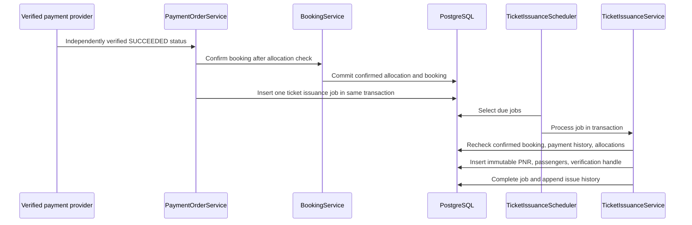

# RailConnect Ticket Management Architecture

Phase 10 adds ticket management to the existing Spring Boot modular monolith. PostgreSQL remains the source of truth; ticketing reads booking snapshots and confirmed passenger allocations and does not change payment or inventory state.

## Trust boundaries

- Booking confirmation remains controlled by `BookingService.confirmAfterVerifiedPayment`.
- `PaymentOrderService` queues a durable ticket job only after payment success has been independently verified and booking confirmation succeeds.
- `TicketIssuanceScheduler` retries the queued job. `TicketIssuanceService.issueJob` rechecks the confirmed booking, successful payment history, and confirmed allocation rows before writing a ticket.
- Passenger APIs enforce owner scoping. Staff APIs require dedicated ticket authorities. Public QR verification returns only the minimum non-passenger details.
- `TicketPdfService` renders a PDF from server-side records; the browser provides no ticket content.
- Signing private material is deployment configuration, never stored in PostgreSQL or returned by an API.

## Persistence

Flyway `V14__create_ticket_management.sql` adds `tickets`, `ticket_passengers`, `ticket_verification_tokens`, `ticket_issuance_jobs`, `ticket_issue_history`, `ticket_audit_logs`, and public-verification rate-limit state. A unique booking constraint makes issuance one-ticket-per-booking; a unique PNR constraint and immutable database trigger protect the PNR. Ticket passenger details are issuance snapshots linked to the booking-passenger source.

## Confirmation-to-issuance sequence

## Browser surfaces

- Passenger Portal: responsive booking and ticket history, owner-scoped details, PNR search, and private PDF download.
- Administration Portal: permission-protected ticket search and issuance diagnostics.
- Operations Portal: permission-protected PNR verification with journey and berth information, without passenger names or payment configuration.
- `/verify-ticket/{token}` is a responsive public verification page and only confirms a RailConnect record.

## Operational configuration

Set `RAILCONNECT_TICKET_SIGNING_KEY_ID`, `RAILCONNECT_TICKET_SIGNING_PRIVATE_KEY` (base64 PKCS#8 Ed25519 DER), and `RAILCONNECT_TICKET_VERIFICATION_PUBLIC_KEY` (base64 X.509 Ed25519 DER) using the deployment secret manager. Set `RAILCONNECT_TICKET_PUBLIC_VERIFICATION_ORIGIN` to the HTTPS public page origin ending in `/verify-ticket`. Configure `RAILCONNECT_TICKET_FONT_PATH` to an installed Unicode TrueType font readable by the service (for example DejaVu Sans on Linux). Never put the private key in source control, SQL, a browser variable, PDF metadata, or logs.

The public verification signing key configuration supports the currently active key ID. Keep old tickets within their configured token expiry during rotations; coordinated multi-key verification is not yet implemented.

## Phase boundary

This phase issues and verifies `ISSUED` tickets only. Cancellation, refunds, reallocation, and subsequent phases are out of scope. A RailConnect PNR is not an official Indian Railways or IRCTC PNR.
