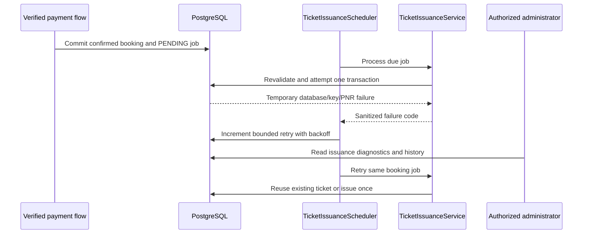

# Ticket Issuance Recovery

Ticket issuance is decoupled from payment and allocation through `ticket_issuance_jobs`. The payment-confirmation transaction records a job after the booking and allocation are confirmed. If ticket creation fails, that transaction rolls back without reversing payment confirmation; the scheduled worker retries the job.

The worker also backfills confirmed bookings that predate the ticketing job, but only when a verified successful payment and a confirmed allocation for every passenger are present and no ticket or job exists. It enqueues the existing booking for normal issuance checks; it never creates or modifies a payment, allocation, or existing PNR.

## Failure and retry sequence

Retries are bounded to ten attempts with exponential backoff capped at five minutes. Failure codes and `ticket_issue_history` do not contain passenger details or credentials. An authorized administrator can inspect current attempt count, last failure code, and event history through `/api/v1/admin/tickets/{ticketId}/diagnostics`, or find jobs that have not yet produced a ticket through `/api/v1/admin/tickets/issuance-failures`.

Document generation is on-demand and does not create another ticket. Each success/failure is audited and appended to issue history; a later authorized download regenerates the PDF from the same authoritative ticket and booking snapshots. A PDF or signing configuration outage therefore cannot cause another charge, seat allocation, or PNR.

## Operator recovery

1. Inspect the authorized ticket diagnostics and service health.
2. Resolve the deployment/database/signing/font issue using server logs without exposing keys or passenger data.
3. Allow the scheduled worker to retry. No endpoint creates a new payment or allocation.
4. If the job reaches `FAILED` after ten attempts, an authorized railway or super administrator can request a new bounded attempt through `/api/v1/admin/tickets/issuance-failures/{bookingReference}/retry`. This resets the retry counter, keeps the same booking/job, rechecks payment and allocation, and records an audit event. It cannot change an existing ticket or create an arbitrary ticket.

Ticket cancellation, refunds, and reallocation are not recovery operations in this phase.
