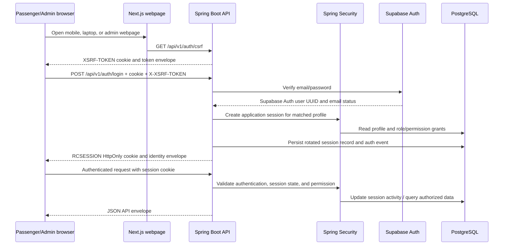

# Authentication architecture

## Request flow

## Components and trust boundaries

- Passenger and admin Next.js apps are browser clients. They call the API through the shared `@railconnect/api` workspace and never connect directly to PostgreSQL.
- Supabase Auth owns email/password credentials and email confirmation. The backend verifies credentials through the Supabase Auth API; the browser never receives the service-role key.
- Spring Security protects the Spring Boot API with the existing server-side cookie/session model. Supabase Auth user UUIDs are the primary keys for matching rows in `railconnect.users`; roles and application profile fields stay in PostgreSQL. HTTP Basic and form login are disabled.
- PostgreSQL stores identity, role grants, throttles, audit events, and Spring Session state in the configured `railconnect` schema.
- CORS accepts exact configured origins and credentials. Do not replace the allowlist with a wildcard.
- Mutating requests use CSRF protection. The API helper first gets a CSRF token, then sends it in `X-XSRF-TOKEN`; the browser supplies cookies with credentials.

## Login and registration behavior

Registration and login are rate limited using database records keyed by HMAC hashes. Registration returns a uniform acknowledgement for a new, duplicate, or rate-limited request to reduce direct account enumeration; this response does not imply contact verification or delivery. Login failures return the same generic credentials error for unknown, invalid, suspended, or disabled accounts.

Sensitive staff mutations require recent authentication. The one-time Super Administrator bootstrap is disabled by default, requires explicit environment values, creates the initial account, and exits the process. Bootstrap credentials must never be placed in source control or shared logs.

## Authorization

Permission checks are enforced at backend controller methods. The seeded Super Administrator receives the full Phase 2 permission catalogue. Role grants can contain a global or resource-specific scope, but no railway-domain endpoint exists yet; future station/train/reservation services must explicitly enforce those scopes rather than assuming the schema alone provides isolation.

See [session management](session-management.md), [password security](password-security.md), and [admin access control](admin-access-control.md).
