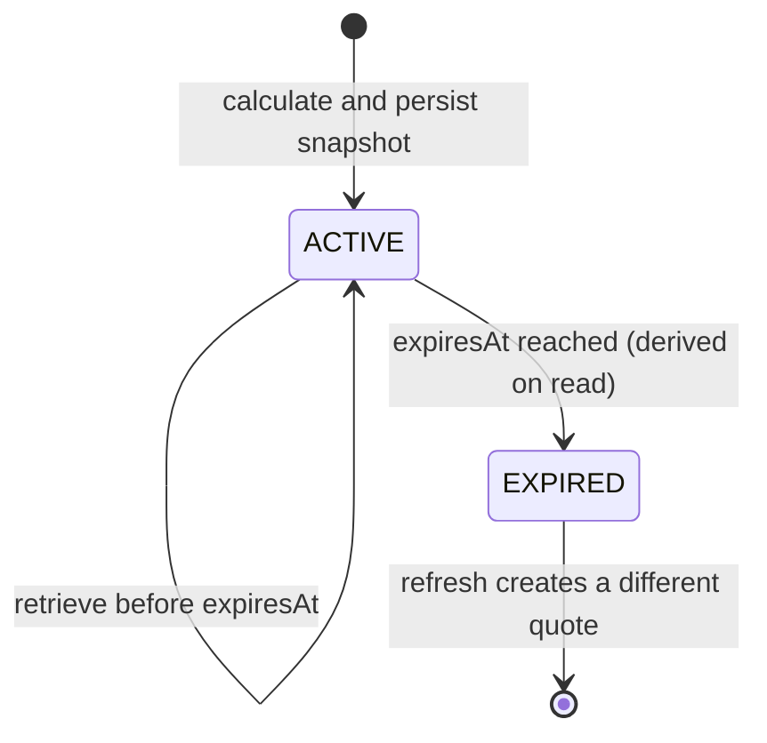

# Fare quote lifecycle

Quote states are derived from the stored expiry timestamp: a new quote is `ACTIVE` until `expiresAt`; reads after that point return `EXPIRED`. Quote creation time, expiry, itemized amounts, journey context, and selected rule version are persisted together. A refresh creates a new UUID and a new snapshot; it never mutates or extends the earlier quote.

The response snapshot is immutable at the database layer. The random UUID is the only public lookup handle for an anonymous quote; authenticated quotes are bound to their owner user ID, and other users receive the same not-found result as for a nonexistent quote. No passenger name, contact information, or age is stored in the quote snapshot.

Expiry invalidates the quote as a displayable estimate only; it is not a booking lock and does not reserve price, inventory, seat, or train service. Expired quote retention and deletion require a separately approved data-retention policy; automatic purge is not implemented in this phase.

See [fare-quote-lifecycle.mmd](diagrams/fare-quote-lifecycle.mmd) for the standalone diagram.
