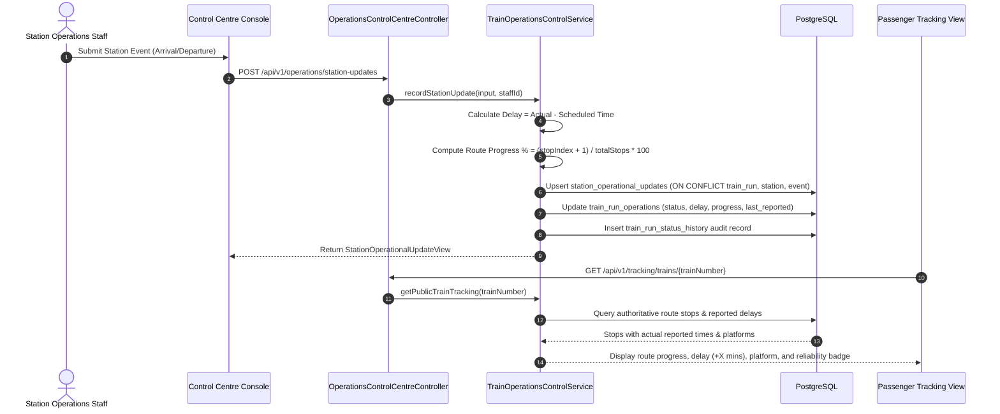

# Railway Operations & Control Centre Architecture (Phase 13)

This document specifies the operational architecture for RailConnect's Railway Operations & Control Centre.

---

## 1. Architectural Principles

1. **Independent Internal Tracking (Zero Third-Party Tracking APIs)**:
   - RailConnect tracks trains purely through authorized station and operations personnel updates.
   - Strictly no integration with RapidAPI, RailRadar, IRCTC.dev, or paid GPS map tracking providers.
   - Transparent data reliability indicators: `STAFF_VERIFIED`, `AWAITING_STATION_UPDATE`, or `SCHEDULED_ONLY`.

2. **Station-Based Tracking & Downstream Delay Propagation**:
   - Authorized personnel record real-world events (`ARRIVAL`, `DEPARTURE`, `PASSING`) with actual vs scheduled timestamps.
   - Dynamic delays ($\Delta = \text{Actual} - \text{Scheduled}$) are calculated and propagated downstream along the route.

3. **Platform Management & Overlap Conflict Detection**:
   - Platforms are tracked per station with active slot allocations.
   - Interval intersections are prevented using PostgreSQL transaction locks (`FOR UPDATE`):
     $$\text{Slot}_A \cap \text{Slot}_B = \emptyset \quad \forall A \neq B \text{ on same platform}$$

4. **Incident & Disruption Workflows**:
   - Disruptions trigger passenger impact assessments: counts affected confirmed, RAC, and waitlist passengers without deleting bookings.

---

## 2. Sequence Diagram: Station Update & Downstream Delay Calculation

